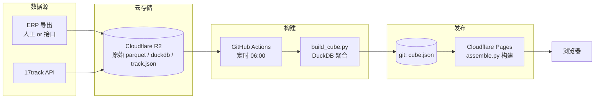

# 部署方案

> 目标：把这个看板放到线上、数据自动更新、并接入 17track。
> 写于 2026-11-17，基于当时的数据（1,325,618 履约单，2026-01-01 ~ 11-12）。

---

## 一、先说结论

| 问题 | 结论 |
|---|---|
| 网站能上吗 | **能，今天就上**。看板是纯静态单文件，Cloudflare Pages 直接托管，零服务器成本 |
| 数据能自动更新吗 | **暂时不能**。现在数据是人工从 ERP 导出 parquet，没有自动数据源，这是唯一的硬卡点 |
| 17track 接得进吗 | **能**，但它不是"给看板加个图"这么简单，是一套独立的采集任务，见第六节 |
| 一共要多久 | 上网站 1 天；自动取数 3~5 天（取决于 ERP 有没有接口）；17track 1~2 周 |

**最需要你先拍板的不是技术选型，是这件事：ERP 侧能不能给出稳定、自动的数据出口。**
能，后面的路是通的；不能，就只能做成"人工上传 → 自动重建"的半自动形态。

---

## 二、现在是什么

```
ERP 导出 parquet（人工）
      ↓
   履约单.duckdb（509MB，本地）
      ↓  build_cube.py（duckdb + openpyxl）
   dashboard_src/cube.json（845KB，预聚合立方体）
      ↓  assemble.py（纯标准库）
   public/index.html（1.9MB，单文件零依赖）
```

关键约束：
- **`.duckdb` 509MB，不可能进 git**，也不适合每次构建都下载 500MB
- `cube.json` 只有 845KB 且是文本，**适合进仓库**，每次更新 diff 很小
- `assemble.py` 只用 Python 标准库，**任何 CI 都能跑，不需要装 duckdb**

这个分层很关键：**数据更新只改 `cube.json`，构建完全无依赖。**

---

## 三、卡点：数据怎么自动进来

现状是人工从 ERP 导出，文件名还带时间戳（`履约单数据_2026_11_16_12_30.parquet`）。三条路：

| 方案 | 需要什么 | 工期 | 稳定性 |
|---|---|---|---|
| **A. ERP 开放接口 / SFTP** | IT 提供 API 或定时文件推送 | 取决于 IT | 最好，真正无人值守 |
| **B. 人工上传到云存储** | 一个网页/按钮把导出文件丢进 R2 | 2 天 | 够用，人工点一下 |
| **C. 维持现状** | 本地跑完脚本手动 push | 0 | 看着像自动，其实不是 |

建议**先做 B，同时推 A**。B 能马上让"更新数据"变成"上传一个文件"，不依赖 IT 排期；
A 谈成了就把 B 的入口换掉，下游不用改。

---

## 四、推荐架构

和你已有的 `weekly-meeting`（Cloudflare Pages + D1 + Actions）、`transfer-order-cloudflare` 一致，
不引入新的技术栈。



### 选择理由

| 环节 | 选型 | 为什么 |
|---|---|---|
| 托管 | **Cloudflare Pages** | 静态站免费、国内可访问、支持私有仓库、与你现有项目一致 |
| 构建 | Pages 构建命令 `python assemble.py` | 纯标准库，不需要装 duckdb，构建 3 秒 |
| 数据中转 | **R2** | 509MB 的库放对象存储最合适；出站流量免费 |
| 定时任务 | **GitHub Actions** | 免费额度足够（每天 2 分钟 ≈ 60 分钟/月），能跑 DuckDB |
| 数据落地 | **commit `cube.json`** | 比每次传 1.9MB HTML 干净，diff 可读，回滚容易 |

### 为什么不选其他

- **GitHub Pages**：私有仓库发 Pages 需要付费版；而且 Pages 不支持构建命令，没法跑 `assemble.py`
- **Vercel / Netlify**：一样能用，但你的生态在 Cloudflare，没必要多一个账号
- **VPS**：每月几十块换来的是运维负担，这个规模用不上
- **把 509MB 库塞进 git**：直接不可行，GitHub 单文件硬上限 100MB

---

## 五、三期落地

### P1 · 上线（1 天，现在就能做）

1. 仓库 `fulfillment-dashboard`（私有）— **已完成**
2. Cloudflare Pages 连这个仓库：
   - Build command：`python assemble.py`
   - Build output directory：`public`
   - 环境变量：无
3. 打开分配的 `*.pages.dev` 域名即可访问

**这期的"更新数据" = 本地跑 `python build_cube.py` 然后 commit `cube.json`，Pages 自动重建。**
一条命令的事，但确实是人触发的。

### P2 · 数据自动化（3~5 天）

1. 建 R2 bucket，配一个上传入口（最简单：Cloudflare Pages Functions 做一个上传页）
2. GitHub Actions 加定时任务：
   ```yaml
   on:
     schedule: [{cron: "0 22 * * *"}]   # UTC 22:00 = 北京时间 06:00
   ```
3. Job 流程：下载 R2 最新 parquet → 拼成 duckdb → `build_cube.py` → commit `cube.json`
4. 失败告警：Action 挂了发邮件/飞书

### P3 · 17track（1~2 周）

见下一节。

---

## 六、17track 接入

### 6.1 接入量（按当前数据实测）

| 口径 | 数量 |
|---|---|
| 在途池（已签出 + 物流异常 + 待收货） | **53,325** |
| 其中库龄 0-30 天（值得注册的） | **13,787** |
| 其中库龄 120 天以上（基本是丢件，注册也查不到） | 22,966 |
| 日均新增签出 | **4,221** |
| 月均新增 | **≈126,600** |

### 6.2 计费模型决定了策略

17track 是**按注册单号数计费**，不是按查询次数：

- 注册 1 个号 = 1 份配额；**注册成功后自动跟踪不再扣费**
- 官方自动跟踪：注册后每 6~12 小时一次，已签收/异常每 24 小时一次，**不需要自己写轮询**
- 连续 30 天无事件自动停止跟踪；已签收保持 15 天停止
- 2026-01-07 起取消每月 100 免费额度，新账号一次性给 200 个

> **所以成本 = 每月注册多少个号，不是查多少次。**
> 而一个履约单最多有 3 个单号（主单号 / 转单号 / 头程单号）——**一单只注册 1 条腿**，否则成本 ×3。

### 6.3 分层灰度

| 层级 | 覆盖 | 月均注册量 |
|---|---|---|
| T1 | 南非 postnet + 尼日利亚 SF + 物流异常 + 超期未达 | ≈6,700 |
| T2 | Hete / YFH / XS / DHL / UPS | ≈17,800 |
| T3 | WYT-USPS + Yun Express | ≈101,000 |

**5.3% 的投入能覆盖 100% 的问题单**（南非线 WMS 签收率 0%、尼日利亚 17.8%），
而 T3 占 80% 的成本，边际价值最低。建议先只跑 T1。

### 6.4 承运商编码（已核实）

17track 在册 3,598 家，我方 10 家全部命中，附加参数全为可选：

| 物流服务商 | 17track carrier |
|---|---|
| WYT-USPS | `190284` WINIT 万邑通 |
| Hete-Logistics | `191376` 3PE EXPRESS |
| postnet | `100644` PostNet |
| Yun Express | `190008` YunExpress |
| SF Express | `100012` SF Express |
| DHL | `101266` |
| UPS | `100002` |
| YFH-Logistics | `190389` |
| XS_Express | `190477` |

完整表见 `reference/17track_carriers.json`。

### 6.5 实现形态

```
GitHub Actions（每 30 分钟）
  ├─ 从 R2 读「待注册」队列 + 「已注册」台账
  ├─ POST /track/v2.2/register   （单次最多 40 号，限流 3 req/s）
  ├─ POST /track/v2.2/gettrackinfo（轮询未签收的号）
  ├─ 写回 track.json → R2
  └─ 有变化时 commit，触发 Pages 重建
```

注意事项：
- 首次调用新号几乎总是返回空，**要等 6~12 小时**才有数据，别当成失败
- `-18019901` = 已注册（**不扣费**，静默跳过）
- `-18019903` = 承运商识别不出，换传 carrier 或走人工
- `-18019908` = 配额用尽，必须告警（官方明确**不支持自动续购**）
- **不要传 `lang` 参数**，翻译会额外多扣 1 份配额

### 6.6 看板怎么用这些数据

新增 `track.json`，与 `cube.json` 并列注入。多出三类图：

1. **轨迹异常** — 停滞 >N 天、投递失败、退件、清关扣关
2. **签收对账** — 承运商签收 vs WMS 签收。重点盯「WMS 已签但承运商查无」，疑似虚假签收
3. **真实时效** — 用承运商事件算的物流天数，替代现在 WMS 回填的自证数据

---

## 七、安全

**这个看板含真实业务数据**（各平台单量、仓库、承运商、目的国分布）。
一旦挂到公网，任何拿到 URL 的人都能看到。

| 措施 | 做法 |
|---|---|
| 仓库 | 私有（已设） |
| 站点 | **建议开 Cloudflare Access**，只放公司邮箱登录，免费额度 50 人 |
| 17track token | 放 GitHub Secrets / Cloudflare Secrets，**绝不进仓库** |
| 数据库 | `.duckdb` 已在 `.gitignore`，不进 git |
| 如果一定要公开 | 至少把平台名、仓库代码脱敏后再部署 |

---

## 八、成本

| 项目 | 免费额度 | 超出 |
|---|---|---|
| Cloudflare Pages | 无限静态请求 | — |
| Cloudflare R2 | 10GB 存储 / 100 万次写 | $0.015/GB/月 |
| GitHub Actions（私有仓库） | 2,000 分钟/月 | $0.008/分钟 |
| Cloudflare Access | 50 用户 | $3/用户/月 |
| 17track | 新账号一次性 200 个号 | 按套餐，需询价 |

按当前规模（每天 2 分钟构建 + 每天 5MB parquet），**全在免费额度内**。
唯一要花钱的是 17track 配额。

---

## 九、需要你决定的事

1. **ERP 能不能给自动数据出口？**（接口 / SFTP / 只能人工导出）—— 这个决定 P2 的做法
2. **站点给谁看？** 加 Cloudflare Access 登录，还是公开链接
3. **17track 先买多少配额？** 建议先按 T1 的 6,700/月试跑一个月
4. **域名**：用 `*.pages.dev` 还是绑自己的域名
